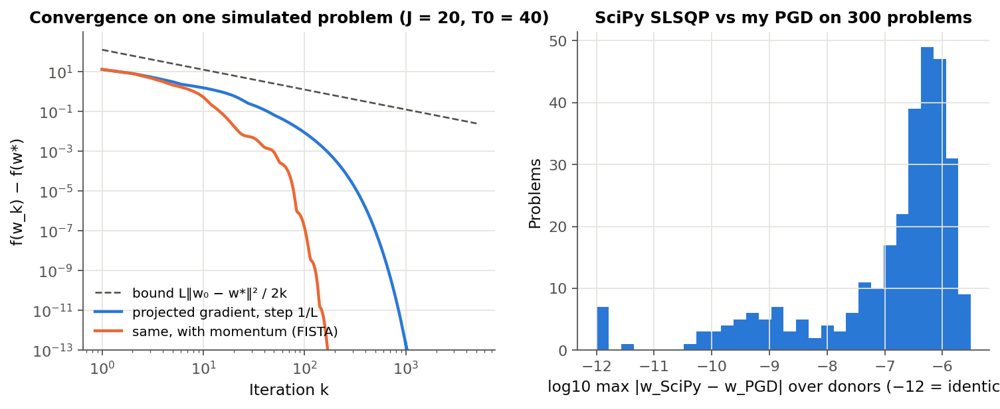
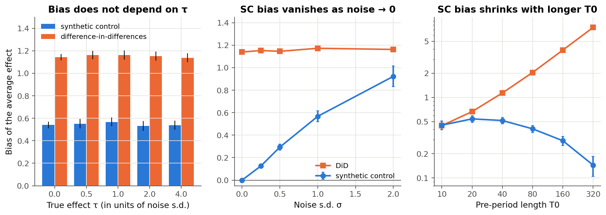
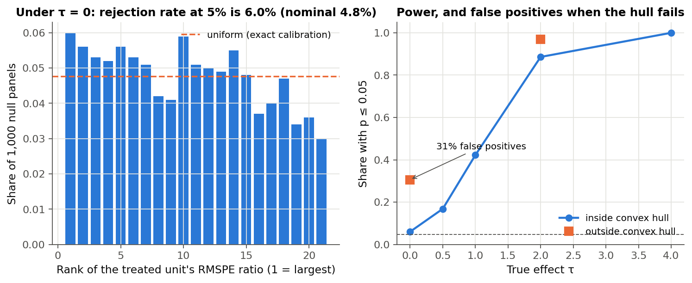
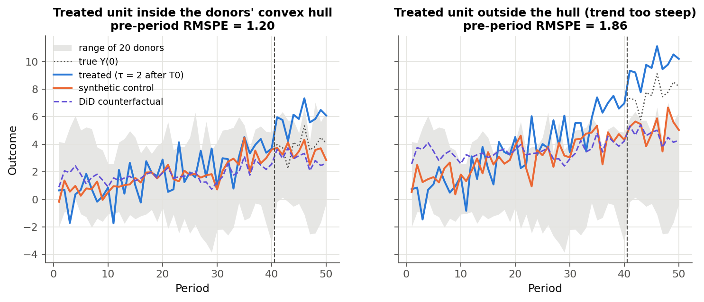
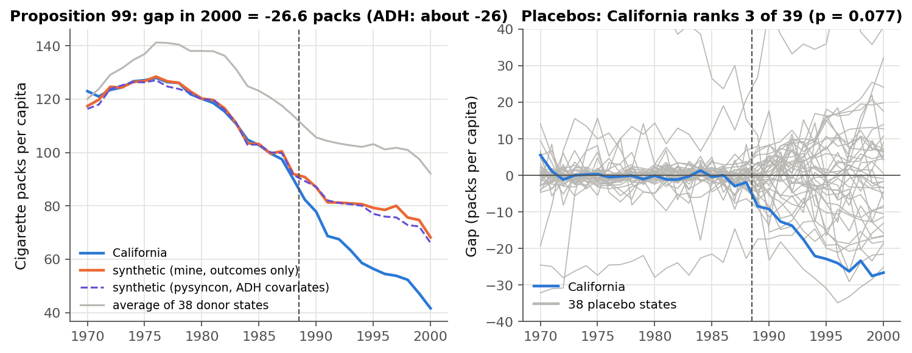
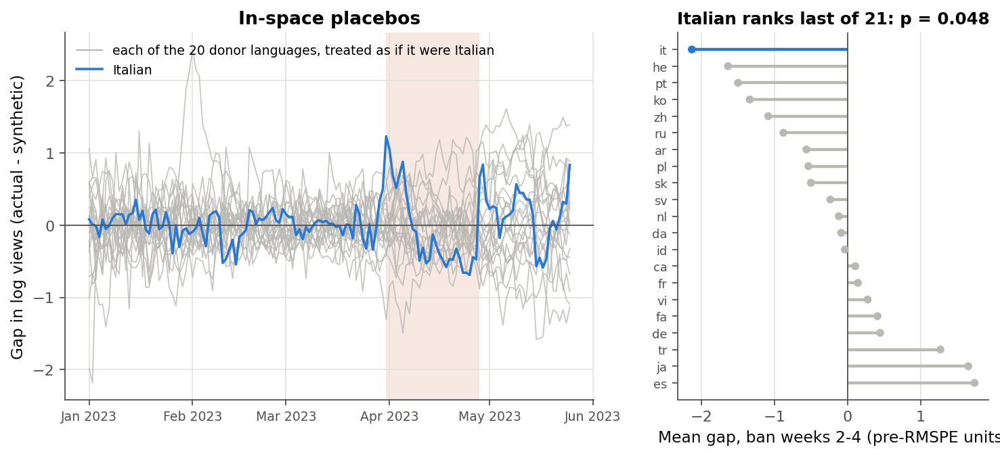
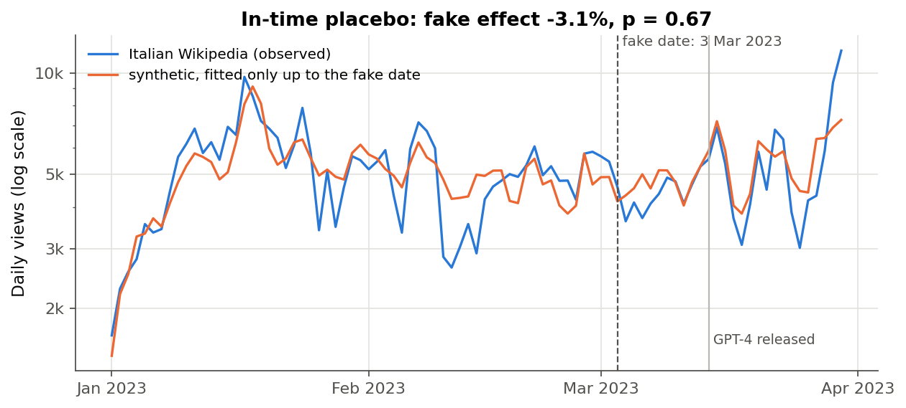
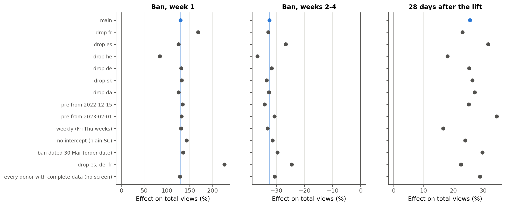
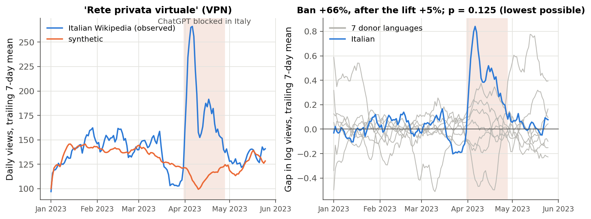

# Did It Work? Method and full results

This file holds the derivations, the simulation study, the library and Proposition 99 checks, and the full Italy analysis behind the [README](README.md). The README gives the short version. Every number here comes from a file in [`results/`](results/).

**Contents**

[Results at a glance](#results-at-a-glance)

1. [The question and the estimand](#1-the-question-and-the-estimand)
2. [Synthetic control as a constrained least-squares problem](#2-synthetic-control-as-a-constrained-least-squares-problem)
3. [Two solvers](#3-two-solvers)
4. [Why it works: the factor-model argument](#4-why-it-works-the-factor-model-argument)
5. [Inference with placebos](#5-inference-with-placebos)
6. [Simulation study](#6-simulation-study)
7. [Agreement with an established implementation](#7-agreement-with-an-established-implementation)
8. [Real data: Italy's ChatGPT ban](#8-real-data-italys-chatgpt-ban)
9. [What I checked](#9-what-i-checked)

---

## Results at a glance

| Question | Answer |
|---|---|
| Do my two solvers agree? | Yes. On 300 simulated problems the largest weight difference between SLSQP and my projected gradient descent is 3.1 × 10⁻⁶, and the objectives agree to a relative 2.4 × 10⁻¹¹. On the Italian ChatGPT data the weights agree to 2.0 × 10⁻⁷. |
| Does it recover planted effects? | It finds them, but it is not unbiased in finite samples. With noise s.d. 1 and 40 pre-periods the bias is 0.53 to 0.57 for every true effect from 0 to 4 (RMSE about 0.72). DiD on the same panels has bias 1.14 to 1.16 (RMSE about 1.23), because the trends are not parallel. The synthetic control bias falls to zero as the noise falls (0.13 at σ = 0.25, exactly 0 at σ = 0) and shrinks with a longer pre-period (0.14 at T0 = 320). |
| Is the placebo test calibrated? | Roughly. Under no effect it rejects at the 5% level in 6.0% of 1,000 panels (s.e. 0.75%; the nominal size with 20 donors is 1/21 = 4.8%). Power is 17%, 42%, 89% and 100% for effects of 0.5, 1, 2 and 4 noise s.d. |
| What happens outside the convex hull? | The method fails: bias 2.89 with no true effect, and 31% false positives. The pre-period fit flags it. The treated unit has the worst pre-period fit of all 21 units in 60% of these panels, against 0.3% when it lies inside the hull. |
| Agreement with `pysyncon` | On the same objective, the weights agree to within 8.7 × 10⁻⁵ on 50 simulated panels, 2.3 × 10⁻⁸ on the Italian ChatGPT panel and 8.6 × 10⁻⁶ on Proposition 99. |
| Proposition 99 | My outcome-only synthetic California puts weight on Utah, Montana, Nevada, Connecticut, New Hampshire and Colorado and gives a gap of −26.6 packs per capita in 2000. Abadie, Diamond and Hainmueller (2010) report about −26. My placebo p-value is 3/39 = 0.077, not their 1/39 (see §7). |
| Italy's ChatGPT ban, week 1 | Views of the Italian ChatGPT article were 2.3 times the synthetic control as the ban made the news: **+130%, about 48,700 extra views** (31 Mar to 6 Apr 2023). Italy ranks first of 21 on the RMSPE ratio, **p = 1/21 = 0.048**, the smallest possible. Pre-period RMSPE 0.186 log points. |
| Ban, weeks 2–4 | With ChatGPT out of reach, views fell **32% below** the synthetic control (about 31,800 fewer views). Italy has the most negative standardised gap of all 21 units, **p = 0.048**. Across 14 specifications the effect is −25% to −37%. |
| After access returned | The deficit stops: +26% over the 28 days after the lift (p = 0.62, not different from zero). |
| Checks | In-time placebo with a fake date of 3 March, a window that includes the GPT-4 release: −3.1%, p = 0.67. Dropping the three donors whose own regulators reacted (Spanish, German, French) shrinks weeks 2–4 to −25% (p = 0.22), so some of the deficit may be spillover. The 28-day ban window I fixed in advance gives only +12.5%, because it adds the news spike to the drop. |
| VPN article | +66% during the ban (+145% in week 1, +41% in weeks 2–4), +5% after the lift. Only 7 donor languages have enough VPN views, so the smallest possible p is 1/8 = 0.125, which it reaches. Suggestive, not conclusive. |

## 1. The question and the estimand

**Potential outcomes.** There are $J+1$ units observed over periods $t = 1,\dots,T$. Unit 1 is treated after period $T_0$; units $2,\dots,J+1$ (the *donors*) are never treated. Each unit has two potential outcomes, $Y_{it}(0)$ without treatment and $Y_{it}(1)$ with it, and we observe

$$Y_{1t} = \begin{cases} Y_{1t}(0) & t \le T_0 \\ Y_{1t}(1) & t > T_0 \end{cases}, \qquad Y_{jt} = Y_{jt}(0) \text{ for every donor } j.$$

**Estimand.** The effect on the treated unit in each post-treatment period,

$$\tau_t = Y_{1t}(1) - Y_{1t}(0), \qquad t > T_0.$$

$Y_{1t}(1)$ is observed. $Y_{1t}(0)$, what would have happened without treatment, is never observed, so the whole problem is to estimate it. With one treated unit there is no randomisation to lean on, and the estimand is a path for one unit, not an average over a population.

**Assumptions.** These are what the method needs, and what I return to when it fails:

* **No interference (SUTVA).** The donors' outcomes are not affected by the treatment. If the Italian ban also makes Spanish readers look ChatGPT up, for example because their own regulator reacts, Spanish Wikipedia is a bad donor.
* **No anticipation.** The treated unit does not react before $T_0$.
* **Convex hull.** The treated unit's untreated path can be matched by a weighted average of donors. Section 4 makes this precise.

## 2. Synthetic control as a constrained least-squares problem

The idea of Abadie and Gardeazabal (2003) and Abadie, Diamond and Hainmueller (2010) is to build $\hat Y_{1t}(0)$ as a weighted average of donors, choosing weights that make it track the treated unit before treatment. Stack the pre-period outcomes as $y = (Y_{11},\dots,Y_{1T_0})^\top \in \mathbb R^{T_0}$ and $X \in \mathbb R^{T_0 \times J}$ with column $j$ the pre-period path of donor $j$. The weights solve

$$\hat w = \arg\min_{w \in \Delta} \; f(w) = \lVert y - Xw \rVert^2 = \sum_{t \le T_0}\Big(Y_{1t} - \sum_j w_j Y_{jt}\Big)^2, \qquad \Delta = \Big\{ w \in \mathbb R^J : w_j \ge 0,\ \sum_j w_j = 1 \Big\},$$

and the estimated effect is the post-period gap

$$\hat\tau_t = Y_{1t} - \sum_j \hat w_j Y_{jt}, \qquad t > T_0.$$

The constraints are the point of the method. Non-negative weights that sum to one mean the synthetic unit is an *interpolation* of real units, not an extrapolation, and the weights are easy to read. Without them this is just regression of $y$ on $X$, which can fit the pre-period perfectly with large positive and negative weights and then extrapolate badly.

I use the outcome-only version: the weights match pre-period outcomes, not covariates. The original papers also match covariates through a second weight matrix $V$; I compare with that version in §7.

**A free intercept.** The basic method must match the *level* of the treated series. A common relaxation (Doudchenko and Imbens 2016; Ferman and Pinto 2021) subtracts each unit's pre-period mean first, so the synthetic unit only has to match the *shape*, and its level is set by an intercept. I call this the demeaned synthetic control. It matters in §4, where it turns out that difference-in-differences is a special case of it.

**KKT conditions.** $f$ is convex (its Hessian $2X^\top X$ is positive semi-definite) and the constraints are linear, so the KKT conditions are necessary and sufficient for a minimum. With multipliers $\nu$ for $\sum_j w_j = 1$ and $\mu_j \ge 0$ for $w_j \ge 0$, the Lagrangian is

$$\mathcal L(w,\nu,\mu) = f(w) + \nu\Big(\sum_j w_j - 1\Big) - \sum_j \mu_j w_j.$$

Stationarity gives $\nabla_j f(w) = \mu_j - \nu$, and complementary slackness gives $\mu_j w_j = 0$. So at the optimum

$$\nabla_j f(\hat w) = -\nu \ \text{ if } \hat w_j > 0, \qquad \nabla_j f(\hat w) \ge -\nu \ \text{ if } \hat w_j = 0, \qquad \nabla_j f(w) = -2\,x_j^\top (y - Xw).$$

In words: every donor in the synthetic control has the same covariance with the residual, and no donor left out would lower the error by being added. This also gives a cheap certificate of optimality. For any feasible $w$, convexity gives $f(w^\star) \ge f(w) + \nabla f(w)^\top (w^\star - w)$, and a linear function on the simplex is smallest at a vertex, so

$$f(w) - f(w^\star) \;\le\; g(w) = \nabla f(w)^\top w - \min_j \nabla_j f(w).$$

$g$ is the Frank–Wolfe gap. It is never negative and it is zero exactly when the KKT conditions hold. I use it as the stopping rule for my solver and to check SciPy's answers.

**Uniqueness.** If $X$ has full column rank (this needs $T_0 \ge J$), $f$ is strictly convex and $\hat w$ is unique. If not, $f$ is still strictly convex as a function of the fitted path $z = Xw$, so the pre-period synthetic path is unique, but the weights, and so the post-period path, may not be. This matters for Proposition 99 ($T_0 = 19$ years, $J = 38$ states) and for weekly data. In practice the solutions I found were sparse and all three solvers returned the same weights.

## 3. Two solvers

### Solver 1: SciPy

`scipy.optimize.minimize` with SLSQP, the analytic gradient, bounds $0 \le w_j \le 1$ and the equality constraint. This is a general-purpose sequential quadratic programming method. It is fast here, but it is a black box.

### Solver 2: projected gradient descent

Take a gradient step, then project back onto the simplex:

$$w_{k+1} = \Pi_\Delta\!\Big(w_k - \tfrac1L \nabla f(w_k)\Big), \qquad \nabla f(w) = -2X^\top(y - Xw).$$

**The projection.** $\Pi_\Delta(v) = \arg\min_{w \in \Delta} \tfrac12\lVert w - v\rVert^2$. Its Lagrangian is $\tfrac12\lVert w - v\rVert^2 + \theta(\sum_j w_j - 1) - \sum_j\beta_j w_j$. Stationarity, $w_j - v_j + \theta - \beta_j = 0$, together with $\beta_j w_j = 0$ and $\beta_j \ge 0$, gives

$$w_j = \max(v_j - \theta,\, 0)$$

for a single threshold $\theta$. The sum $\sum_j \max(v_j - \theta, 0)$ is continuous and decreasing in $\theta$, so exactly one $\theta$ makes it equal 1. Sort $v$ so that $u_1 \ge u_2 \ge \dots \ge u_J$. If the $\rho$ largest entries stay positive, then $\sum_{r\le\rho}(u_r - \theta) = 1$, so

$$\rho = \max\Big\{ j : u_j - \tfrac1j\Big(\sum_{r \le j} u_r - 1\Big) > 0 \Big\}, \qquad \theta = \frac1\rho\Big(\sum_{r \le \rho} u_r - 1\Big).$$

This is the algorithm of Duchi et al. (2008) and Wang and Carreira-Perpiñán (2013). It is exact and costs $O(J \log J)$ for the sort ([`simplex.py`](src/synthcontrol/simplex.py)).

**Why step $1/L$ converges.** The gradient is Lipschitz: $\lVert\nabla f(a) - \nabla f(b)\rVert = \lVert 2X^\top X(a-b)\rVert \le L\lVert a - b\rVert$ with $L = \lambda_{\max}(2X^\top X)$, the largest eigenvalue of the Hessian. This gives the descent lemma, a quadratic upper bound that touches $f$ at $w_k$:

$$f(w) \le f(w_k) + \nabla f(w_k)^\top(w - w_k) + \tfrac L2 \lVert w - w_k\rVert^2.$$

Completing the square shows that the projected step minimises this bound over $\Delta$. Since the bound equals $f(w_k)$ at $w = w_k$, the step can only lower $f$: in fact $f(w_{k+1}) \le f(w_k) - \tfrac L2\lVert w_{k+1} - w_k\rVert^2$. Chaining this with convexity gives the standard rate

$$f(w_k) - f(w^\star) \le \frac{L\,\lVert w_0 - w^\star\rVert^2}{2k}.$$

If $X$ has full column rank, $f$ is also $m$-strongly convex with $m = \lambda_{\min}(2X^\top X) > 0$, and the error falls geometrically, $\lVert w_k - w^\star\rVert^2 \le (1 - m/L)^k \lVert w_0 - w^\star\rVert^2$. A step longer than $2/L$ can diverge, which is why $L$ has to be computed (I use the largest singular value of $X$, squared and doubled). I start from equal weights and stop when $g(w_k)$, relative to $f$ at equal weights, is below $10^{-10}$.

For large runs I also use the accelerated version (FISTA, with a restart when the momentum points uphill). It is the same projection and the same step; only the point where the gradient is taken changes ([`solvers.py`](src/synthcontrol/solvers.py)).

*Left:* on one simulated problem ($J = 20$, $T_0 = 40$, condition number of $2X^\top X$ = 517), both versions stay under the $O(1/k)$ bound and then converge geometrically, as strong convexity predicts. *Right:* SciPy and my solver on 300 simulated problems of different sizes, including 58 where $X$ is rank-deficient.

| Over 300 problems | SciPy SLSQP | My PGD (step 1/L) | PGD + momentum |
|---|---:|---:|---:|
| Median iterations | – | 1,740 | 220 |
| Median time (varies from run to run) | 1.4 ms | 21.7 ms | 3.8 ms |
| Largest weight difference from PGD | 3.1 × 10⁻⁶ | – | – |

My solver reached an equal or lower objective than SciPy in 97% of problems, and was always within a relative $2.4 \times 10^{-11}$. SciPy is faster; mine is transparent and carries its own optimality certificate.

## 4. Why it works: the factor-model argument

**The model.** Suppose untreated outcomes follow a linear factor model,

$$Y_{it}(0) = \delta_t + \lambda_t^\top \mu_i + \varepsilon_{it},$$

with common shocks $\delta_t$, $F$ unobserved factors $\lambda_t$, unit-specific loadings $\mu_i$, and noise $\varepsilon_{it}$ with mean zero. Units respond to the same shocks with different strengths, so their trends are not parallel.

**Sketch of the ADH (2010) argument.** Suppose weights $w$ reproduce the treated unit exactly in the pre-period: $\sum_j w_j Y_{jt} = Y_{1t}$ for all $t \le T_0$. Write $\Lambda_P$ for the $T_0 \times F$ matrix of pre-period factors and $\varepsilon^P_i$ for unit $i$'s pre-period noise. Since $\sum_j w_j = 1$, the $\delta_t$ cancel and exact fit says

$$\Lambda_P\Big(\mu_1 - \sum_j w_j\mu_j\Big) = \sum_j w_j\varepsilon^P_j - \varepsilon^P_1.$$

If $\Lambda_P^\top\Lambda_P$ is invertible, solve for the loading mismatch and substitute into the post-period error. For $t > T_0$,

$$Y_{1t}(0) - \sum_j w_jY_{jt} = \underbrace{\lambda_t^\top(\Lambda_P^\top\Lambda_P)^{-1}\Lambda_P^\top\Big(\sum_j w_j\varepsilon^P_j - \varepsilon^P_1\Big)}_{\text{(A)}} \;-\; \underbrace{\Big(\sum_j w_j\varepsilon_{jt} - \varepsilon_{1t}\Big)}_{\text{(B)}}.$$

Term (B) has mean zero, because post-period noise is independent of the weights. Term (A) need not, because the weights were chosen using the pre-period noise. But (A) is a weighted average of $T_0$ noise terms with weights of order $1/T_0$ when the factors are bounded and $\Lambda_P^\top\Lambda_P/T_0$ stays away from singular. ADH bound its mean by a quantity that goes to zero as $T_0$ grows relative to the noise scale. So: **if the pre-period fit is good over a long pre-period, matching outcomes has matched the unobserved loadings $\mu_1$, and the bias is small.** Matching many periods is what forces the loadings to match, since noise cannot mimic a long factor path for long.

Two consequences I test in §6:

* The bias is driven by noise. With $\varepsilon = 0$, (A) is exactly zero.
* If no convex combination of donor loadings equals $\mu_1$ (the treated unit is outside the convex hull), exact fit is impossible, the identity above breaks, and nothing makes the bias vanish. The warning sign is a poor pre-period fit.

**How DiD differs.** With one treated unit, the two-way fixed-effects DiD counterfactual is

$$\hat Y^{\text{DiD}}_{1t}(0) = \bar Y_{Dt} + \big(\bar Y^{\text{pre}}_1 - \bar Y^{\text{pre}}_D\big), \qquad \bar Y_{Dt} = \frac1J\sum_j Y_{jt},$$

which is a demeaned synthetic control with the weights *fixed* at $1/J$ instead of optimised. Under the factor model its bias is

$$\mathbb E\big[\hat\tau^{\text{DiD}}_t\big] - \tau_t = \big(\lambda_t - \bar\lambda^{\text{pre}}\big)^\top\big(\mu_1 - \bar\mu_D\big),$$

which is zero only if the factors do not move ($\lambda_t = \bar\lambda^{\text{pre}}$) or the treated unit loads on them like the average donor ($\mu_1 = \bar\mu_D$). That is the parallel-trends assumption. Synthetic control replaces it with a weaker one: some weighted average of donors loads like the treated unit.

## 5. Inference with placebos

With one treated unit there is no sampling distribution to appeal to. ADH instead ask: is the treated unit's gap unusual compared with what we get when we pretend a donor was treated?

**In-space placebos.** For each donor $j$, fit a synthetic control for $j$ using the other donors (the real treated unit is left out, since its post-period is affected), and record its gap path. The test statistic is the ratio of post- to pre-period root mean squared prediction error,

$$r_i = \frac{\text{RMSPE}^{\text{post}}_i}{\text{RMSPE}^{\text{pre}}_i}, \qquad \text{RMSPE}^{\text{pre}}_i = \Big(\frac1{T_0}\sum_{t \le T_0}\hat\tau_{it}^2\Big)^{1/2}.$$

Dividing by the pre-period RMSPE matters. A donor that cannot be fitted well before treatment will have large gaps afterwards too, and should not count as evidence against the treated unit. The p-value is the treated unit's rank:

$$p = \frac{1 + \#\{j : r_j \ge r_1\}}{J + 1}.$$

If treatment had been assigned to one of the $J+1$ units at random, every rank would be equally likely, so $P(p \le k/(J+1)) = k/(J+1)$ exactly. Ties count against the treated unit. The smallest possible p-value is $1/(J+1)$, so with 20 donors no result can be "significant at 1%".

This is a test of a sharp null (no effect for anyone), under an exchangeability assumption that is rarely literally true. The treated unit was not picked at random, and §6 shows what happens when it is systematically different from the donors.

**In-time placebo.** Move the treatment date back into the pre-period, fit using only data before the real date, and look at the "effect" of the fake date. A large one means the method finds effects where there are none, usually because the synthetic control drifts.

Code: [`inference.py`](src/synthcontrol/inference.py).

## 6. Simulation study

**Design.** Panels from the factor model above with $J = 20$ donors, $T_0 = 40$ pre-periods, 10 post-periods and noise $\sigma = 1$ ([`dgp.py`](src/synthcontrol/dgp.py)):

* Factor 1 is a linear trend rising by 6 over the sample. Factors 2 and 3 are AR(1) with coefficient 0.8. Unit fixed effects are a fourth, constant factor.
* Donor loadings are uniform on $[0,1]$. The treated unit's loadings are a Dirichlet-weighted average of the 4 donors with the largest trend loading, so it lies **inside** the donors' convex hull but far from their average. That is the setting where synthetic control should beat DiD.
* For the **outside** design, I then push its trend loading 0.6 above the largest donor's, so no convex combination can match it.
* A constant effect $\tau \in \{0, 0.5, 1, 2, 4\}$ is added after $T_0$: 1,000 panels for $\tau = 0$, 500 for each other case, each with a full set of 21 placebo fits.

These runs use the accelerated version of my solver; it agrees with the plain version (tested).

| Design | τ | Panels | SC bias | SC RMSE | Demeaned SC bias | DiD bias | DiD RMSE | Share with p ≤ 0.05 |
|---|---:|---:|---:|---:|---:|---:|---:|---:|
| inside | 0 | 1,000 | 0.541 | 0.724 | 0.563 | 1.145 | 1.231 | 0.060 |
| inside | 0.5 | 500 | 0.553 | 0.728 | 0.577 | 1.163 | 1.242 | 0.168 |
| inside | 1 | 500 | 0.567 | 0.721 | 0.593 | 1.163 | 1.246 | 0.422 |
| inside | 2 | 500 | 0.532 | 0.720 | 0.565 | 1.155 | 1.242 | 0.886 |
| inside | 4 | 500 | 0.539 | 0.717 | 0.569 | 1.139 | 1.221 | 1.000 |
| outside | 0 | 500 | 2.888 | 2.957 | 2.062 | 3.136 | 3.168 | 0.306 |
| outside | 2 | 500 | 2.817 | 2.895 | 2.070 | 3.137 | 3.172 | 0.970 |

**What this shows.**

1. **Estimation error does not depend on the size of the effect.** Bias and RMSE are flat across $\tau$, as they should be for an additive effect.
2. **DiD's bias is exactly what the formula in §4 predicts.** The trend factor's post-period mean exceeds its pre-period mean by $6 \times (45.5 - 20.5)/50 = 3.0$. The treated unit's expected trend loading is the expected mean of the top 4 of 20 uniforms, $(20+19+18+17)/(4 \times 21) = 0.881$, against 0.5 for the average donor. So the predicted bias is $3.0 \times 0.381 = 1.14$. The simulated bias is 1.145.
3. **Synthetic control is better, but not unbiased.** Its bias of about 0.54 surprised me at first. The sweeps show it is the noise term (A) from §4: the bias is 0.13, 0.29, 0.57 and 0.92 at $\sigma$ = 0.25, 0.5, 1 and 2, and zero (7 × 10⁻⁹) without noise. With noisy donors, weights fitted to the pre-period spread onto donors with smaller trend loadings, so the synthetic unit under-predicts the trend. A longer pre-period helps: with the per-period trend held fixed, the bias falls from 0.54 at $T_0 = 20$ to 0.14 at $T_0 = 320$, while DiD's grows (part of this is the trend signal growing relative to the noise). The free intercept does not help here (bias 0.56).
4. **The placebo test is close to calibrated, slightly liberal.** Under $\tau = 0$ it rejects in 6.0% of panels at the 5% level (nominal 4.8%, s.e. 0.75%) and 11.6% at 10% (nominal 9.5%). The rank histogram below leans slightly towards small ranks. That is the bias at work: a well-fitted treated unit with a biased post-period gap gets a larger RMSPE ratio than the placebos.
5. **Outside the convex hull it fails, and the pre-period fit shows it.** The bias is 2.89 with no true effect, and the test rejects in 31% of null panels. But the median pre-period RMSPE is 1.67, against 0.96 inside the hull (where it is close to $\sigma$, as it should be). In 98.3% of outside panels the pre-period RMSPE exceeds the 95th percentile of the inside panels, and in 60% the treated unit has the worst pre-period fit of all 21 units (0.3% inside). The first threshold needs knowledge of $\sigma$ that real data does not give you. The second does not, and it is the check I would use in practice.

*One panel of each design with τ = 2.* Inside the hull, the synthetic control (orange) tracks the true untreated path (dotted) after $T_0$ and DiD (purple dashed) falls below it. Outside the hull, the treated unit's trend is steeper than any mixture of donors, so the synthetic control lags behind it already in the pre-period, and after $T_0$ the error adds to the true effect.

Code: [`scripts/simulate.py`](scripts/simulate.py). Results: [`results/simulation_summary.md`](results/simulation_summary.md), [`results/simulation_sweeps.csv`](results/simulation_sweeps.csv).

## 7. Agreement with an established implementation

**pysyncon on the same problem.** `pysyncon` (version 1.7.0) installed without trouble on Python 3.9. Its `Synth` class solves for weights with SLSQP after dividing each row of the predictor matrix by its standard deviation across units. To make its objective identical to mine, I pass the pre-period outcomes as predictors and set its diagonal $V$ to each row's variance, which undoes the scaling.

| Data | Largest weight difference, mine vs pysyncon | Effect difference |
|---|---:|---:|
| 50 simulated panels | 8.7 × 10⁻⁵ | 1.1 × 10⁻⁴ (mean post gap) |
| Italian ChatGPT panel | 2.3 × 10⁻⁸ | mean log gap 0.032339 vs 0.032339 |
| Proposition 99 | 8.6 × 10⁻⁶ | gap in 2000: −26.597 vs −26.597 |

I expect the remaining differences come from pysyncon running SLSQP at SciPy's default tolerance ($10^{-6}$), but I did not investigate further.

**Replicating Proposition 99.** California raised its cigarette tax and funded anti-smoking campaigns from 1989. The data are the standard 39-state panel of per-capita cigarette sales, 1970 to 2000 (from the `SyntheticControlMethods` repository; saved in [`data/external/`](data/external/)).

| | Weights | Gap in 2000 | Mean gap 1989–2000 |
|---|---|---:|---:|
| Mine, outcomes only | Utah 0.394, Montana 0.232, Nevada 0.205, Connecticut 0.109, New Hampshire 0.045, Colorado 0.015 | −26.6 | −19.5 |
| pysyncon, ADH covariates and fitted $V$ | Utah 0.310, Nevada 0.226, Colorado 0.201, Montana 0.086, Connecticut 0.073, New Mexico 0.071, Idaho 0.032 | −24.5 | −18.0 |
| ADH (2010), Table 2 and text | Utah 0.334, Nevada 0.234, Montana 0.199, Colorado 0.164, Connecticut 0.069 | about −26 | |

The donor states are the same five, with similar weights, and the estimated effect is close to the published one. The covariate version is not reproduced exactly even by pysyncon, because the outer optimisation over $V$ (Nelder–Mead) has many near-equivalent solutions. That is a known weakness of the covariate-weighted method and one reason I use the outcome-only version.

My placebo test does *not* reproduce ADH's p-value of 1/39. California has the third-largest RMSPE ratio (12.4); Missouri (23.9) and Virginia (19.8) are larger, because their outcome-only pre-period fits are very tight (pre-RMSPE 0.44 and 0.82 packs, against 1.66 for California). So $p = 3/39 = 0.077$. Dropping placebos whose pre-period RMSPE is more than 2 or 5 times California's gives 0.103 and 0.086 (ADH use a similar rule on the mean squared error). ADH's placebos use their covariate-weighted fits, which I did not rerun for 38 placebo states. The point estimate replicates; the significance depends on the specification.

**A solver lesson from this data.** Here $X$ has rank 19 with 38 donors, so $f$ is not strongly convex and plain projected gradient descent only has the $O(1/k)$ guarantee. After 200,000 steps it had not converged (Frank–Wolfe gap 2.9, weights off by up to 0.021). The accelerated version converged in 9,060 steps and agrees with SciPy to 1.9 × 10⁻⁵. The table uses the accelerated result.

Code: [`scripts/validate_against_library.py`](scripts/validate_against_library.py). Results: [`results/library_agreement.json`](results/library_agreement.json), [`results/prop99.json`](results/prop99.json), [`results/solver_agreement.json`](results/solver_agreement.json).

## 8. Real data: Italy's ChatGPT ban

### The event and the outcome

On 30 March 2023 Italy's data-protection authority, the Garante per la protezione dei dati personali, ordered OpenAI to stop processing Italian users' data. OpenAI blocked ChatGPT in Italy on **31 March 2023**. It restored access on **28 April 2023**, after making changes the Garante had asked for. The dates are sharp, the decision was a surprise, and the ban was switched off again four weeks later. That makes it a good fit for synthetic control, with a second test built in: if the ban caused a change, the change should stop or reverse when access comes back.

The outcome is daily views of the **ChatGPT article on Italian Wikipedia**, human traffic only (`agent=user`), from the [Wikimedia Pageviews API](https://wikimedia.org/api/rest_v1/). The API counts a view under the title that was requested, so for every language I add up the views of the article's title and of every title that redirects to it, found through the MediaWiki API ([`wiki_pageviews.py`](scripts/wiki_pageviews.py)). I work with log views. Effects are reported as a percentage of total views, $\sum_t V^{\text{obs}}_t / \sum_t \hat V_t - 1$ with $\hat V_t = \exp(\text{synthetic log views})$, and as extra (or missing) views.

**Windows.** Pre-period: 1 January to 30 March 2023 (89 days, mean 5,110 views a day). ChatGPT itself only launched on 30 November 2022, so this is as long as the pre-period can be: every donor article exists from early January. Before fitting anything I fixed two 28-day windows: the **ban** (31 March to 27 April) and the **lift** (28 April to 25 May). The weights are fitted on the pre-period only and then held fixed, so the lift window is a second out-of-sample test of the same synthetic control.

### Donors, and what this design can and cannot identify

The donors are the same article in other language editions. Each edition is read mostly in countries where ChatGPT stayed available, and all of them saw the same global news: the GPT-4 release on 14 March, the "pause giant AI experiments" open letter on 29 March, and so on. I started from 26 language editions whose article had at least a few hundred views a day in early 2023 ([`italy_config.py`](scripts/italy_config.py)). I left out English (and Simple English) on purpose: English Wikipedia is read all over the world, including by Italians, so it could be directly affected.

**Data screen.** On donors only, I drop a language if it has days with zero views in the window (the article did not exist yet), fewer than 100 views a day, or a single day more than 5 times the median of the 15 days around it (a burst of automated traffic). This removed Ukrainian (one day at 11 times its local median) and Czech, Hungarian, Greek, Romanian and Finnish (no recorded views until some day between 7 and 24 January). **20 donors** remain.

**Spillover is the main threat.** The ban was international news, and regulators elsewhere reacted inside the ban window: Spain's data-protection agency opened an investigation and the European Data Protection Board set up a ChatGPT task force on 13 April, and German and French regulators said publicly that they were examining it. If that news raised interest in ChatGPT among Spanish, German or French readers, the synthetic Italy is pushed up during the ban and the Italian deficit looks larger than it is. I check this by dropping those three languages.

What the design **can** identify: the total effect of the ban, meaning the loss of access together with the news about it, on how often Italian-language Wikipedia readers looked ChatGPT up, relative to readers of other languages. What it **cannot** identify: whether people used ChatGPT less (Wikipedia views are not usage, and some people used VPNs); the effect on Italians specifically (Italian Wikipedia is also read in Switzerland, where ChatGPT stayed available, which would dilute any effect); or how much of the effect is news and how much is lost access. I can only separate the last two by timing.

### Main result

The synthetic Italy is **French 0.339, Spanish 0.262, Hebrew 0.233, German 0.074, Slovak 0.066, Danish 0.026** (demeaned log views, my projected gradient solver, 5,240 iterations; SciPy agrees to 2.0 × 10⁻⁷). It tracks Italy with a pre-period RMSPE of 0.186 log points, against 0.455 for DiD on the same data, and there is no drift before the ban: the average gap over the last 28 pre-period days is −0.006.

The two windows I fixed in advance give an unhelpful answer for the ban: **+12.5%** over the 28 days (p = 0.048 on the RMSPE ratio, but 0.52 on the average gap). The weekly path shows why. The total adds up two effects with opposite signs:

| Week | Dates | Observed | Synthetic | Difference | Effect |
|---|---|---:|---:|---:|---:|
| ban 1 | 31 Mar – 6 Apr | 86,214 | 37,471 | +48,743 | +130% |
| ban 2 | 7 – 13 Apr | 26,294 | 34,611 | −8,317 | −24% |
| ban 3 | 14 – 20 Apr | 21,409 | 32,073 | −10,664 | −33% |
| ban 4 | 21 – 27 Apr | 18,312 | 31,106 | −12,794 | −41% |
| lift 1 | 28 Apr – 4 May | 51,600 | 36,154 | +15,446 | +43% |
| lift 2 | 5 – 11 May | 48,786 | 35,747 | +13,039 | +36% |
| lift 3 | 12 – 18 May | 29,908 | 33,842 | −3,934 | −12% |
| lift 4 | 19 – 25 May | 38,452 | 28,533 | +9,919 | +35% |

So, after seeing the first run, I split the ban window into its first week and the remaining three weeks. This split was chosen after looking at the data, and I report it alongside the pre-specified windows, not instead of them.

| Window | Effect | Extra views | p (RMSPE ratio) | p (average gap, two-sided) |
|---|---:|---:|---:|---:|
| Ban, all 28 days (pre-specified) | +12.5% | +16,968 | 0.048 | 0.524 |
| Ban, week 1 | **+130%** | +48,743 | **0.048** | 0.048 |
| Ban, weeks 2–4 | **−32%** | −31,775 | 0.048 | **0.048** |
| Lift, all 28 days (pre-specified) | +26% | +34,470 | 0.333 | 0.619 |

With 20 donors the smallest possible p-value is 1/21 = 0.048, so "first of 21" is as strong as this test can get. In the first week Italy has the largest RMSPE ratio of all 21 units, and in weeks 2–4 it has the most negative average gap (2.14 pre-period RMSPEs below zero; the next largest in absolute size are Spanish at +1.74 and Hebrew at −1.64).

**Reading it.** The first week is the news: in the first three days views were 2.75 times the synthetic (+175%). From the second week, with ChatGPT out of reach, Italian readers looked it up about a third less than the synthetic control predicts, and the deficit grew week by week. When access came back, views jumped (+88% in the first three days of the lift, news again) and over the lift window as a whole they were no longer below the synthetic (+26%, p = 0.62). The deficit does not continue after access returns, which is what I would expect if the ban caused it.

Italy had two public holidays in weeks 2–4 that the donor countries mostly did not share: Easter Monday (10 April) and Liberation Day (25 April). Leaving those two days out, the weeks 2–4 effect is −31%, so the holidays do not explain it.

### The in-time placebo

Fitting only on 1 January to 2 March and pretending the ban started on 3 March, the synthetic control predicts the next 28 days to within 3.1% (p = 0.67), and that window contains the GPT-4 release. Common shocks are absorbed by the donors, and the synthetic control does not drift away from Italy by itself.

### Sensitivity

Full table: [`results/italy_chatgpt_sensitivity.md`](results/italy_chatgpt_sensitivity.md). Across 14 specifications (main, leave-one-out for each of the 6 weighted donors, pre-period from 15 December or from 1 February, weekly data, no intercept, the ban dated 30 March, dropping Spanish, German and French, and no data screen):

* **Week 1** is between +85% and +227%, and Italy has the largest RMSPE ratio in all 14, so every p-value is the minimum possible, $1/(J+1)$.
* **Weeks 2–4** are between −25% and −37%. Italy has the most negative average gap in 8 of the 14 (p = 0.048 to 0.067) and ranks second to fourth in the other 6: pre-period from 1 February (p = 0.077), no data screen (0.091), weekly data and no intercept (0.14 each), dropping Spanish (0.15), and dropping Spanish, German and French (0.22).
* **After the lift**, the effect is between +17% and +35%, with p between 0.46 and 0.71 in every specification. The deficit never carries on after access returns.
* **Spillover check.** Without Spanish, German and French the weeks 2–4 effect shrinks from −32% to −25%, and the pre-period fit gets worse (RMSPE 0.238). That is what spillover into those donors would look like, though with 17 donors and a worse fit it is also within the noise. I read −25% as a conservative size for the deficit.
* **Shorter or longer pre-periods.** Starting on 15 December keeps only 14 donors (several articles did not exist yet) and gives −34%; starting on 1 February gives −31%.

### A second outcome: the VPN article

If the ban mattered to people, some should have looked for ways around it. I ran the same analysis on the Italian article *Rete privata virtuale* (virtual private network), with the VPN article in the other languages as donors. The VPN articles get far fewer views (138 a day in Italian before the ban), and only **7 donor languages** pass the 100-views-a-day rule (Spanish, German, French, Portuguese, Russian, Chinese and Persian).

| Window | Effect | p (RMSPE ratio) |
|---|---:|---:|
| Ban, all 28 days | +66% | 0.125 |
| Ban, week 1 | +145% | 0.125 |
| Ban, weeks 2–4 | +41% | 0.125 |
| Lift, all 28 days | +5% | 0.750 |

Views of the Italian VPN article more than doubled in the first week of the ban, stayed about 40% above the synthetic for the rest of it, and went back to normal when access returned. With 7 donors, 0.125 = 1/8 is the smallest p-value the test can give, so this is consistent with an effect but cannot be called significant on its own. Using all 24 languages with complete data, including the ones below 100 views a day, gives +56% over the ban window with p = 0.04, but those series are noisy. The in-time placebo gives −7.9% (p = 0.38). The leave-one-out estimates for the ban window range from +62% to +66%.

**Conclusion.** The ban caused a short burst of attention when it was announced, then a drop of roughly a quarter to a third in how often Italian Wikipedia readers looked ChatGPT up, for as long as the ban lasted. When access returned, the drop stopped. Interest in VPNs rose during the ban and fell back afterwards, the same timing, but on too few donors to be sure. The numbers are about Wikipedia attention, not about ChatGPT usage.

**How BSTS / CausalImpact would compare.** Brodersen et al. (2015) model the treated series as a state-space model (a local level or trend plus a regression on control series, with a spike-and-slab prior that chooses controls) and forecast it past the event, with posterior intervals. Here the synthetic control already fits well and shows no drift, so I would expect a similar point estimate. BSTS would add intervals for each week, but they would rest on the model being right rather than on a placebo distribution. I have not implemented it here.

Code: [`scripts/italy_analysis.py`](scripts/italy_analysis.py). Results: [`results/italy_chatgpt_main.json`](results/italy_chatgpt_main.json), [`results/italy_vpn_main.json`](results/italy_vpn_main.json).

## 9. What I checked

The test suite (`pytest`, 94 test cases, about 20 s) checks each part separately from the figures:

| Check | How |
|---|---|
| Simplex projection is right | Output is on the simplex; it satisfies the KKT form $w_j = \max(v_j - \theta, 0)$; no point among 2,000 random feasible points is closer to $v$; it is idempotent, non-expansive and unchanged by adding a constant to $v$. |
| PGD behaves as the theory says | $L$ equals the largest eigenvalue of $2X^\top X$; the objective never increases; the gap stays under $L\lVert w_0 - w^\star\rVert^2/2k$ for 2,000 iterations; the Frank–Wolfe gap bounds the suboptimality of random feasible points. |
| Solvers agree | SLSQP and PGD give the same weights to 10⁻⁴ on 15 random problems; the accelerated version matches plain PGD in fewer iterations. |
| Known effects are recovered | Noiseless panel where the treated unit is an exact mix of donors: both solvers recover the true weights and constant or time-varying effects to 10⁻³. |
| Intercept works | A treated series shifted 100 units above every donor is fitted perfectly by the demeaned version, and the intercept is 100. |
| Placebo p-values | Exactly rank/(J+1) for every rank, ties counted against the treated unit; always on the grid $\{1/(J+1), \dots, 1\}$; a huge effect gets the minimum. |
| In-time placebo | Uses only pre-period data and finds no effect in a noiseless panel. |
| DiD | Equals the hand formula; exact under parallel trends; biased when the treated unit has its own trend. |
| Simulator | Inside the hull and without noise, the true weights reproduce the treated unit exactly; outside, no fit is possible. |

Beyond the tests: solver agreement on 300 problems and on all real data sets (§3, §7), pysyncon agreement (§7), the Proposition 99 replication (§7), calibration and power by simulation (§6), and an in-time placebo on the real data (§8).

## References

### References

* A. Abadie and J. Gardeazabal (2003). *The Economic Costs of Conflict: A Case Study of the Basque Country.* American Economic Review.
* A. Abadie, A. Diamond and J. Hainmueller (2010). *Synthetic Control Methods for Comparative Case Studies: Estimating the Effect of California's Tobacco Control Program.* Journal of the American Statistical Association.
* A. Abadie (2021). *Using Synthetic Controls: Feasibility, Data Requirements, and Methodological Aspects.* Journal of Economic Literature.
* A. Abadie and J. L'Hour (2021). *A Penalized Synthetic Control Estimator for Disaggregated Data.* Journal of the American Statistical Association.
* N. Doudchenko and G. Imbens (2016). *Balancing, Regression, Difference-in-Differences and Synthetic Control Methods: A Synthesis.* NBER Working Paper 22791.
* B. Ferman and C. Pinto (2021). *Synthetic Controls with Imperfect Pretreatment Fit.* Quantitative Economics.
* E. Ben-Michael, A. Feller and J. Rothstein (2021). *The Augmented Synthetic Control Method.* Journal of the American Statistical Association.
* D. Arkhangelsky, S. Athey, D. Hirshberg, G. Imbens and S. Wager (2021). *Synthetic Difference-in-Differences.* American Economic Review.
* V. Chernozhukov, K. Wüthrich and Y. Zhu (2021). *An Exact and Robust Conformal Inference Method for Counterfactual and Synthetic Controls.* Journal of the American Statistical Association.
* K. Brodersen, F. Gallusser, J. Koehler, N. Remy and S. Scott (2015). *Inferring Causal Impact Using Bayesian Structural Time-Series Models.* Annals of Applied Statistics.
* J. Duchi, S. Shalev-Shwartz, Y. Singer and T. Chandra (2008). *Efficient Projections onto the ℓ1-Ball for Learning in High Dimensions.* ICML.
* W. Wang and M. Carreira-Perpiñán (2013). *Projection onto the Probability Simplex: An Efficient Algorithm with a Simple Proof.* arXiv:1309.1541.
* A. Beck and M. Teboulle (2009). *A Fast Iterative Shrinkage-Thresholding Algorithm for Linear Inverse Problems.* SIAM Journal on Imaging Sciences.
* S. Fordham. *pysyncon: a Python package for the synthetic control method.* github.com/sdfordham/pysyncon.
