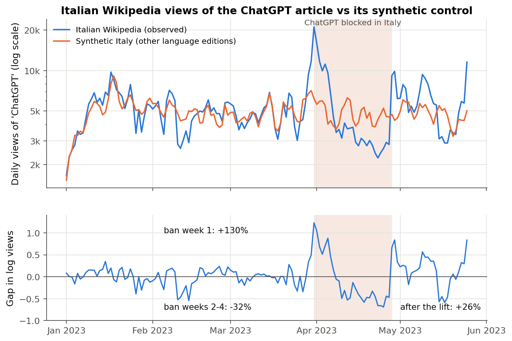
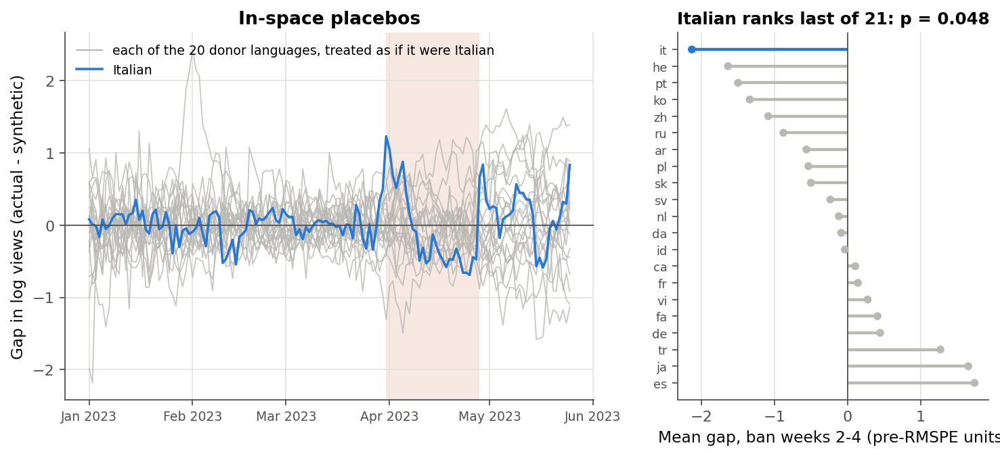

# Did It Work?

Synthetic control written from scratch in NumPy and SciPy, then used on a question about AI regulation: what happened to Italians' interest in ChatGPT when Italy's data-protection authority had it blocked for four weeks in spring 2023? I measure interest as daily views of the ChatGPT article on Italian Wikipedia, and I build a "synthetic Italy" from the same article in other language editions. The ban was lifted after four weeks, which gave me a second test: if the ban caused the change, the change should stop when access came back.

Before trusting it on real data, I checked the estimator on simulated panels with effects I planted myself, against an established library, and on the classic California Proposition 99 study.



## What I found

The ban had two effects that pull in opposite directions. In the first week (31 March to 6 April 2023), as the ban made the news, views of the Italian article were 2.3 times what the synthetic control predicts, about 48,700 extra views. From the second week on, with ChatGPT out of reach, Italian readers looked it up about a third less than the synthetic control predicts (−32%, about 31,800 fewer views), and the gap grew each week. In both windows Italy ranks first of the 21 language editions in the placebo test, so p = 1/21 = 0.048, the smallest value this test can give with 20 donors.

When access returned on 28 April, the deficit stopped, and over the next 28 days views were 26% above the synthetic control, which is statistically indistinguishable from zero (p = 0.62). I think this on-off timing is the strongest evidence in the project that the ban itself caused the drop, since a drift in the synthetic control would have carried on after the lift.

I'm less sure of the exact size of the drop. Before running anything I fixed a single 28-day ban window, and on that window the effect is only +12.5%, because the news spike and the drop mostly cancel. The split into week 1 and weeks 2–4 came after I had seen the weekly numbers, so I report both. Regulators in Spain, Germany and France also reacted to the ban while it was on, which could have raised interest in ChatGPT among their own readers and pushed the synthetic Italy up. Dropping those three languages shrinks the weeks 2–4 effect to −25% (p = 0.22), and that is the size I would quote if pressed. Across 14 specifications the weeks 2–4 effect is between −25% and −37%.

Views of the Italian VPN article also rose during the ban (+66%) and fell back after the lift (+5%), which is the same timing. Only 7 donor languages have enough VPN traffic, though, so the smallest p-value the test can give is 0.125, and it reaches that. It's suggestive, and I wouldn't lean on it alone.

On the method side, my two solvers agree to 3.1 × 10⁻⁶ on 300 simulated problems, and my weights match the `pysyncon` library to within 8.7 × 10⁻⁵. On Proposition 99 I get a gap of −26.6 packs per capita in 2000, close to the roughly −26 in Abadie, Diamond and Hainmueller (2010), although my placebo p-value comes out at 3/39 where theirs is 1/39. What surprised me in the simulations was that synthetic control is biased in small samples. With noise s.d. 1 and 40 pre-periods its effect estimates come out about 0.55 too high, which is still half the bias of difference-in-differences when trends are not parallel. When the treated unit sits outside the range the donors can reach, the method fails badly (31% false positives), and the pre-period fit is how you spot it: in 60% of those panels the treated unit has the worst pre-period fit of all 21 units.

## Data

Daily human page views (`agent=user`) from the Wikimedia Pageviews API, with every redirect to each article added in, so a view under an old title still counts. I work with log views. The pre-period is 1 January to 30 March 2023, 89 days, which is as long as it can be because ChatGPT only launched on 30 November 2022. I started from 26 language editions and left out English, since Italians read it too. A data screen for missing days, low traffic and bot bursts removed six more, leaving 20 donors.

## How it works

A synthetic control is a weighted average of donors chosen to track the treated unit before treatment. With $y$ Italy's pre-period path and $X$ the donors' paths side by side, the weights solve

$$\hat w = \arg\min_{w} \lVert y - Xw \rVert^2 \quad \text{subject to } w_j \ge 0,\ \sum_j w_j = 1,$$

and the estimated effect on each later day is the gap between Italy and $\sum_j \hat w_j Y_{jt}$. The constraints keep the synthetic unit a genuine mix of real donors, so the weights are easy to read and the fit can't wander off with large positive and negative weights. I solve this two ways, with SciPy's SLSQP and with my own projected gradient descent, which needs an exact projection onto the simplex. For inference I refit the method pretending each donor was treated and see where Italy ranks.

Here the synthetic Italy is French 0.339, Spanish 0.262, Hebrew 0.233, German 0.074, Slovak 0.066 and Danish 0.026. It tracks Italy with a pre-period error of 0.186 log points, against 0.455 for difference-in-differences on the same data.

| Window | Effect | Views | p (placebo rank) |
|---|---:|---:|---:|
| Ban, all 28 days (fixed in advance) | +12.5% | +16,968 | 0.048 |
| Ban, week 1 | +130% | +48,743 | 0.048 |
| Ban, weeks 2–4 | −32% | −31,775 | 0.048 |
| After the lift, 28 days (fixed in advance) | +26% | +34,470 | 0.333 |

The p-values are on the RMSPE ratio, as in Abadie et al.; the weeks 2–4 row is also first of 21 on the average gap. A fake ban date of 3 March, a window that includes the GPT-4 release, gives −3.1% (p = 0.67), so the synthetic control does not drift away from Italy by itself.



The derivations (KKT conditions, the simplex projection, why step size 1/L converges, the factor-model argument and why DiD is a special case), the full simulation study, the Proposition 99 replication and every sensitivity check are in [METHOD.md](METHOD.md). The log of what I tried, including what didn't work, is in [EVALS.md](EVALS.md).

## Limitations

Wikipedia views measure how often Italian-language readers looked ChatGPT up, and I can't say from them whether anyone used ChatGPT less. Italian Wikipedia is also read in Switzerland, where ChatGPT stayed available, which would dilute any effect.

I can only separate the news from the loss of access by timing, and as above, the week 1 versus weeks 2–4 split came after I had seen the data. Spillover into the Spanish, German and French donors could also explain part of the deficit.

The pre-period is short, 89 days, and it starts while interest in ChatGPT was still climbing fast, so a longer history would make me trust the weights more. With 20 donors the placebo test can't go below p = 0.048. Bias-corrected or augmented synthetic control and conformal inference for the effect path would be the next things I'd add, and the same design could be run on other countries' temporary blocks of online services.

## Running the code

Requires Python 3.9+.

```bash
python -m venv .venv && source .venv/bin/activate
pip install -r requirements.txt

make test        # pytest, 94 test cases (~20 s)
make simulate    # simulation study (a few minutes; uses all CPU cores)
make validate    # solver agreement, pysyncon, Proposition 99 (~2.5 min)
make analysis    # Italy analysis, offline from data/processed/ (under a minute)
make figures     # every figure from results/
make data        # optional: re-download page views (needs internet)
```

```
src/synthcontrol/
  simplex.py         projection onto the simplex
  solvers.py         SLSQP, projected gradient descent, Frank–Wolfe gap
  synth.py           synthetic control on a T x N panel
  inference.py       in-space and in-time placebos
  did.py             difference-in-differences
  dgp.py             factor-model simulator with planted effects
scripts/             data download, simulation, library checks, Italy analysis, figures
tests/               94 test cases
data/processed/      daily page views used in the analysis
data/external/       Proposition 99 panel
results/             every number quoted here and in METHOD.md
figures/             generated figures
```

### References

* A. Abadie, A. Diamond and J. Hainmueller (2010). Synthetic Control Methods for Comparative Case Studies: Estimating the Effect of California's Tobacco Control Program. *Journal of the American Statistical Association.*
* A. Abadie (2021). Using Synthetic Controls: Feasibility, Data Requirements, and Methodological Aspects. *Journal of Economic Literature.*
* W. Wang and M. Carreira-Perpiñán (2013). Projection onto the Probability Simplex: An Efficient Algorithm with a Simple Proof. arXiv:1309.1541.
* S. Fordham. pysyncon: a Python package for the synthetic control method. github.com/sdfordham/pysyncon.

The full reference list is at the end of [METHOD.md](METHOD.md).
